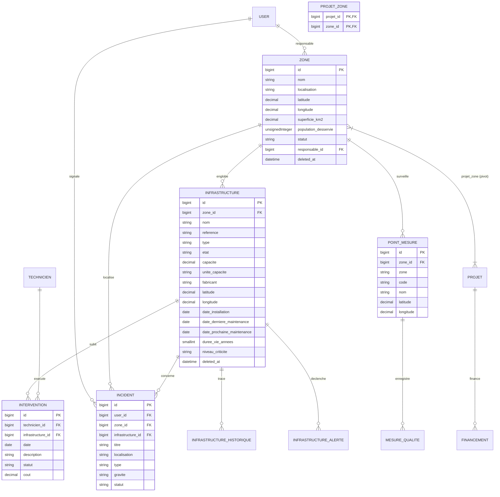

# AquaSecure

AquaSecure est une application web de démonstration pour le suivi et la gestion d’un réseau d’eau. Elle propose des espaces adaptés aux habitants, aux techniciens, aux gestionnaires et aux administrateurs.

> **Prototype de démonstration :** plusieurs écrans s’appuient sur des données fictives et des actions simulées. AquaSecure est une plateforme SaaS .

## Fonctionnalités

- **Espace habitant** : tableau de bord, signalements, factures et notifications.
- **Espace technicien** : interventions, rapports de terrain et inventaire d’équipements.
- **Espace gestionnaire** : incidents, carte et qualité du réseau, équipes, projets, budget, rapports et analyses.
- **Espace administrateur** : utilisateurs, rôles, journaux, sécurité, système et sauvegardes.
- **Interface publique** : présentation de la plateforme et formulaire de demande de démonstration.
- **Assistant de démonstration** : réponses prédéfinies côté navigateur ; il n’est pas relié à un service d’IA.

Les exemples de tableaux et indicateurs sont définis principalement dans `app/Data/PlaceholderData.php`. Les routes web se trouvent dans `routes/web.php`.

## Technologies

- PHP 8.2 ou plus récent
- Laravel 12
- Blade
- SQLite
- Node.js et npm
- Vite 7, Tailwind CSS 4 et JavaScript

## Installation locale

### Prérequis

Installez PHP 8.2+, Composer, Node.js avec npm, ainsi que les extensions PHP requises par Laravel et SQLite (`pdo_sqlite` notamment).

### 1. Installer les dépendances

À la racine du dépôt :

```sh
composer install
npm install
```

### 2. Préparer l’environnement

Copiez `.env.example` vers `.env`, puis générez la clé de l’application :

```sh
# macOS / Linux
cp .env.example .env
php artisan key:generate
touch database/database.sqlite
```

Sous Windows PowerShell :

```powershell
Copy-Item .env.example .env
php artisan key:generate
if (-not (Test-Path database/database.sqlite)) {
    New-Item -ItemType File database/database.sqlite | Out-Null
}
```

Dans `.env`, utilisez les pilotes locaux suivants pour la démonstration :

```dotenv
DB_CONNECTION=sqlite
SESSION_DRIVER=file
CACHE_STORE=file
QUEUE_CONNECTION=sync
```

### Emails des actions correctives

Par défaut, `.env.example` utilise `MAIL_MAILER=log` : les emails sont alors écrits dans `storage/logs/laravel.log` et ne sont pas envoyés à Gmail. Pour envoyer les notifications au citoyen, configurez le SMTP Gmail dans votre fichier `.env` (ne partagez et ne committez jamais le mot de passe d’application) :

```dotenv
MAIL_MAILER=smtp
MAIL_SCHEME=null
MAIL_HOST=smtp.gmail.com
MAIL_PORT=587
MAIL_USERNAME=votre-adresse@gmail.com
MAIL_PASSWORD=mot-de-passe-d-application-google
MAIL_FROM_ADDRESS=votre-adresse@gmail.com
MAIL_FROM_NAME="AquaSecure"
```

Utilisez un mot de passe d’application Google, pas le mot de passe normal du compte. Après modification, exécutez `php artisan config:clear`.

### 3. Préparer la base et les fichiers frontend

```sh
php artisan migrate
npm run build
```

### 4. Démarrer l’application

Dans un terminal :

```sh
php artisan serve
```

Ouvrez <http://127.0.0.1:8000>. Pour travailler sur le frontend avec le rechargement automatique, lancez aussi `npm run dev` dans un second terminal.

## Comptes de démonstration

La connexion reconnaît les adresses ci-dessous, déclarées dans `routes/web.php` :

| Espace | Adresse de démonstration |
| --- | --- |
| Habitant | `citoyen@aquasecure.tn` |
| Technicien | `amira@aquasecure.tn` |
| Gestionnaire | `gestionnaire@aquasecure.tn` |
| Administrateur | `admin@aquasecure.tn` |

Le formulaire de connexion est simulé : dans l’implémentation actuelle, le serveur choisit le compte en fonction de l’adresse et ne vérifie pas le mot de passe. N’utilisez pas cette authentification en production.

## Modules Zones & Infrastructures (Hydraulique & SIG)

Le module **Zones & Infrastructures** assure la gouvernance technique du réseau hydraulique AquaSecure (réservoirs, canalisations, stations de pompage/traitement, forages et vannes) à l'échelle nationale (Tunisie).

### 1. Architecture des Données et Schéma Relationnel



---

### 2. Guide de Collaboration & Impacts pour les Collègues

Toutes les évolutions apportées respectent le principe de **rétrocompatibilité stricte** (aucune ancienne migration n'a été modifiée, toutes les nouvelles clés étrangères sont `nullable` avec `nullOnDelete`).

#### 👷‍♀️ Amira — Module Maintenance & Techniciens
- **Ce qui a été ajouté :**
  - Colonne `infrastructure_id` (clé étrangère nullable) sur la table `interventions` (`2026_10_13_000004_add_infrastructure_id_to_interventions_table.php`).
  - Champ de sélection optionnel *"Infrastructure concernée"* dans le formulaire `manager/interventions/_form.blade.php`.
  - Relation Eloquent `$intervention->infrastructure` et `$infrastructure->interventions`.
  - Observateur `App\Observers\InterventionObserver` : dès qu'une intervention liée à une infrastructure passe au statut **"Terminée"**, la `date_derniere_maintenance` de l'infrastructure est automatiquement actualisée avec la date de l'intervention.
- **Impact & Action requise :** Aucun impact bloquant. Les interventions existantes sans infrastructure continuent de fonctionner sans modification. Le coût cumulé de maintenance est désormais automatiquement calculé sur la fiche technique de chaque ouvrage.

#### 🚨 Ines — Module Incidents & Actions Correctives
- **Ce qui a été ajouté :**
  - Colonnes `zone_id` et `infrastructure_id` (clés étrangères nullables) sur la table `incidents` (`2026_10_13_000005_add_zone_and_infrastructure_to_incidents_table.php`).
  - Préservation intégrale de la colonne texte originale `localisation`.
  - Sélecteurs interactifs avec filtrage dynamique JavaScript dans `front/incidents/form.blade.php` (sélectionner une zone restreint automatiquement la liste des équipements proposés).
  - Affichage direct des incidents non résolus sur les fiches `zones/show.blade.php` et `infrastructures/show.blade.php`.
- **Impact & Action requise :** Le signalement citoyen reste optionnel sur les sélections d'ouvrages. Les signalements sans zone ou infrastructure restent 100% valides.

#### 🧪 Dr. Selim — Module Qualité de l'Eau & Points de Mesure
- **Ce qui a été ajouté :**
  - Colonne `zone_id` (clé étrangère nullable) sur la table `point_mesures` (`2026_10_13_000006_add_zone_id_to_point_mesures_table.php`).
  - Migration de données automatique rattachant par correspondance insensible à la casse l'ancien champ texte `point_mesures.zone` avec `zones.nom`.
  - Relation Eloquent `$zone->pointsMesure` et méthode `$point->zone()`.
  - Affichage en temps réel des analyses et de la conformité physico-chimique sur la fiche zone via `WaterQualityService::assess($point->derniereMesure)`.
- **Impact & Action requise :** Le champ texte historique `zone` a été conservé intact afin de ne casser aucun script ou vue existante de l'espace Qualité.

#### 🏗️ Ghada — Module Projets & Financements
- **Ce qui a été ajouté :**
  - Table pivot `projet_zone` (`2026_10_13_000007_create_projet_zone_table.php`).
  - Relation `belongsToMany` entre `Zone` et `Projet`.
  - Affichage des projets d'investissement en cours et de leur avancement sur la fiche détaillée de chaque zone.
- **Raison du choix technique :** Une table pivot plutôt qu'un champ `zone_id` direct sur `projets` a été retenue car un grand projet d'infrastructure (ex. renforcement de l'adduction du Grand Tunis ou du Sud tunisien) peut traverser plusieurs zones territoriales sans dénaturer la table `projets`.
- **Impact & Action requise :** Aucun impact sur les formulaires ou le modèle `Projet` existant.

---

### 3. Fonctionnalités Avancées Implémentées

1. **Gouvernance & Cycle de Vie :**
   - Enums PHP 8 typés : `InfrastructureType`, `InfrastructureEtat`, `ZoneStatut`, `NiveauCriticite` (avec libellés, icônes et codes couleurs Tailwind).
   - SoftDeletes sur Zones et Infrastructures avec blocage métier de suppression si des ouvrages actifs sont reliés.
   - Traçabilité totale des modifications d'état via `InfrastructureHistorique` (auteur, motif, horodatage).
   - Gestionnaire d'alertes opérationnelles `InfrastructureAlerte` (détection des pannes et dépassements de maintenance).

2. **Algorithme d'Évaluation de Santé (`InfrastructureHealthService`) :**
   - Calcul sur 100 points basé sur :
     - Vétusté (âge réel vs durée de vie nominale)
     - Statut opérationnel (`En service`, `En maintenance`, `Dégradé`, `À l'arrêt`)
     - Criticité (`Faible`, `Moyen`, `Critique`)
     - Alertes et retards de maintenance
   - Rendu visuel par badge avec couleur dynamique (Vert, Jaune, Orange, Rouge).

3. **Contrôles de Saisie Avancés & Expérience Utilisateur :**
   - Validation en temps réel côté client sur tous les formulaires (Zones et Infrastructures) :
     - Compteurs dynamiques de caractères sur les champs textuels (`nom`, `localisation`, `référence`, `motif`).
     - Validation croisée des dates : la date d'installation ne peut pas être dans le futur (`max="today"`), et la date de prochaine maintenance est dynamiquement contrainte à être postérieure ou égale à la dernière maintenance.
     - Contrôle des coordonnées géographiques GPS (bornes WGS 84 : latitude -90 à 90°, longitude -180 à 180°) avec aide visuelle sur le périmètre tunisien (30°-38° N / 7°-12° E).
     - Bannière récapitulative animée avec défilement doux et mise au point automatique sur le premier champ erroné.
     - Prévention du double-clic à la soumission avec indicateur de chargement.
   - Validation serveur exhaustive via FormRequests dédiées avec messages et attributs 100% en français.

4. **Modales de Confirmation Universelles (`<x-ui.confirm-modal />`) :**
   - Remplacement intégral des alertes JavaScript natives (`confirm(...)`) par des modales au design AquaSecure :
     - **Suppression (Danger)** : halo d'ambiance et icône rouge/rose néon, avertissement contextuel (archivage logique Soft Delete et vérification des dépendances).
     - **Modification d'état rapide (Avertissement)** : halo ambre/doré, récapitulatif clair de la transition (de l'état A vers l'état B) avec réversibilité en cas d'annulation.
     - **Résolution d'alertes techniques (Info)** : halo cyan électrique pour la clôture des alertes opérationnelles.
     - Accessibilité clavier native (touche Échap, focus trapping, fermeture au clic en dehors).

5. **Système d'Information Géographique (SIG / Carte Manager) :**
   - Remplacement des données factices de `MapController` par les données réelles en base de données.
   - Intégration Leaflet avec regroupement par clusters (`Leaflet.markercluster`).
   - Filtres par couches (Zones, Infrastructures, Points de mesure), par types et par états.
   - Deep-linking avec centrage et ouverture automatique de popup : `/manager/map?zone={id}` ou `/manager/map?infrastructure={id}`.
   - Sélecteur de coordonnées GPS Leaflet interactif dans les formulaires de création et modification.

6. **Exports d'Inventaire (Streaming CSV & PDF) :**
   - **Streaming CSV UTF-8** : Génération optimisée avec BOM Excel (`\xEF\xBB\xBF`) et séparateur `;` pour un affichage natif dans Microsoft Excel et LibreOffice sans altération des accents.
     - `GET /manager/zones/export/csv`
     - `GET /manager/infrastructures/export/csv`
   - **Fiches Techniques PDF** : Édition professionnelle A4 (DomPDF) incluant cartouche technique, score de santé, coordonnées GPS, historique d'interventions et alertes actives.
     - `GET /manager/zones/{zone}/export/pdf`
     - `GET /manager/infrastructures/{infrastructure}/export/pdf`

7. **API REST Sécurisée :**
   - Points d'accès JSON paginés avec ressources API dédiées (`ZoneResource`, `InfrastructureResource`) :
     - `GET /api/zones` (recherche plein texte `q`, tri, pagination)
     - `GET /api/zones/{zone}` (fiche complète de zone avec métriques)
     - `GET /api/infrastructures` (filtres combinés `zone_id`, `type`, `etat`, tri)
     - `GET /api/infrastructures/{infrastructure}` (fiche technique avec score de santé calculé)
   - **Sécurité & Protection :** Restriction de débit par Rate Limiting via `throttle:60,1` (60 requêtes/minute par client).

---

### 4. Jeu de Données de Démonstration (`DemoSeeder`)

Un seeder idempotent complet est disponible pour initialiser le réseau national tunisien :
- **Zones :** Grand Tunis, Cap Bon, Sahel, Sfax, Bizerte & Nord, Sud & Oasis.
- **Infrastructures géolocalisées :** Stations de traitement (Ghdir El Golla, Belli), réservoirs (Sidi Thabet, Bouargoub, Ksar Hellal), forages profonds (Kébili, Douz), stations de pompage et vannes de régulation.
- **Interventions & Incidents rattachés :** Exemples réalistes de maintenance préventive et corrective avec coûts associés.

Exécution :
```sh
php artisan db:seed --class=DemoSeeder
# Ou réinitialisation complète de l'environnement :
php artisan migrate:fresh --seed
```

---

## Commandes utiles

```sh
npm run dev                    # Vite en mode développement
npm run build                  # Compiler les fichiers frontend
php artisan serve              # Lancer le serveur local
php artisan migrate:fresh --seed  # Réinitialiser et peupler toute la base
php artisan test               # Exécuter les 70 tests automatisés
php artisan test --filter=InfrastructureCrudTest # Tester les contrôles de saisie et CRUD
```
php artisan test --filter=InventaireAndApiModuleTest # Tester spécifiquement le module inventaire & API
```

## Structure du dépôt

```text
app/
  Enums/                     Types, états, criticités et statuts typés
  Http/
    Controllers/
      Api/                   Contrôleurs REST (ZoneApiController, InfrastructureApiController)
      Manager/               Contrôleurs d'administration (CRUD, Exports CSV/PDF, Carte SIG)
    Requests/                FormRequests de validation stricte (Zones, Infrastructures)
    Resources/               API Resources JSON (ZoneResource, InfrastructureResource)
  Models/                    Modèles Eloquent (Zone, Infrastructure, Historique, Alerte...)
  Observers/                 InterventionObserver (mise à jour auto date de maintenance)
  Services/                  Services métier (InfrastructureHealthService, ZoneStatsService)
database/
  migrations/                Migrations rétrocompatibles ordonnées
  seeders/                   Seeders spécialisés et DemoSeeder complet
resources/
  views/
    manager/
      zones/                 Vues CRUD, recherche, tri, filtres et stats
      infrastructures/       Vues CRUD, formulaires interactifs, sélecteur GPS
      exports/               Modèles d'impression PDF pour fiches techniques
      map.blade.php          Carte SIG Leaflet avec cluster et couches
routes/
  web.php                    Routes Manager, exports et filtres
  api.php                    Routes API REST sous rate limiting
tests/
  Feature/                   69 tests de validation et non-régression
```

---

## Limites du prototype

- L'authentification actuelle repose sur la session (`session('user')`).
- Les données géographiques sont projetées en WGS 84 (EPSG:4326) avec Leaflet.

